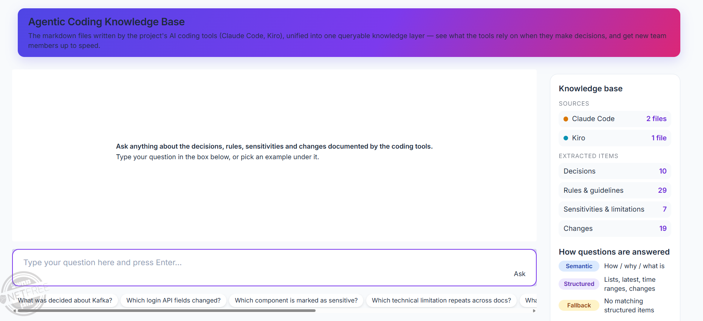
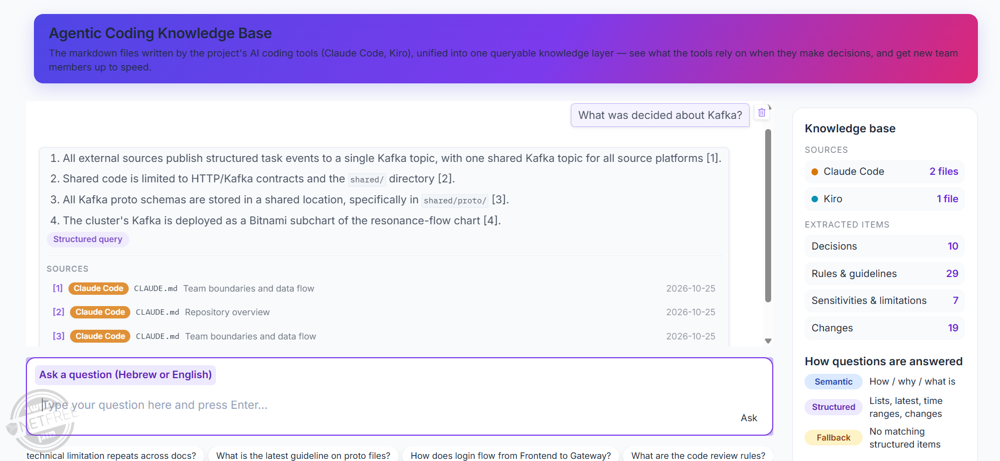
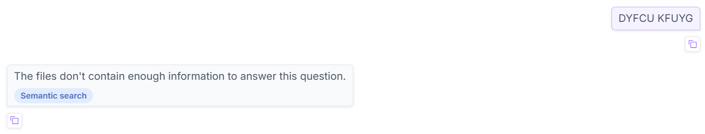
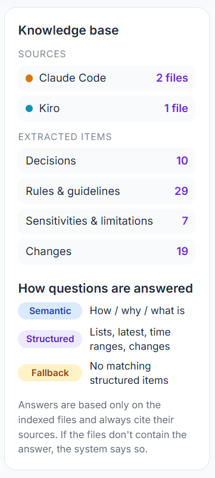
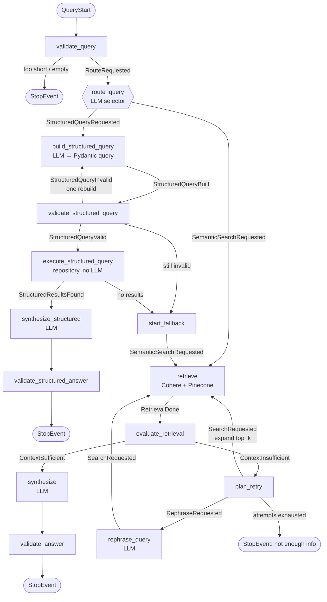
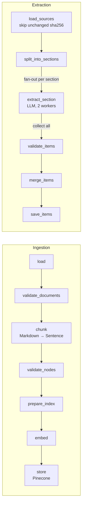

# Agentic Coding RAG with LlamaIndex

**A RAG system that turns the markdown files written by AI coding tools (Claude Code, Kiro) into one queryable knowledge layer.**

AI coding agents leave a trail of markdown behind them — `CLAUDE.md` instructions, Kiro skills, integration summaries.
Those files capture *why* the code looks the way it does: architectural decisions, working rules, known limitations,
and what changed from X to Y. This project indexes them so developers can ask questions like:

> *"What was decided about Kafka?"* · *"Which login API fields changed?"* · *"Which component is marked as sensitive?"*
> *"What is the latest guideline on proto files?"* · *"איזו מגבלה טכנית חוזרת בכמה מסמכים?"*

…and get **grounded answers with sources** — in the language they asked in (Hebrew or English).




---

## Why not plain RAG?

Top-k semantic search is good at *"how does X work?"*, but weak at three kinds of questions that come up all the time
when you try to understand what an AI agent based its decisions on:

| Question type | Example | What it needs |
|---|---|---|
| **List** | "Give me all the technical decisions" | Full coverage, not the 5 closest chunks |
| **Recency** | "What is the *current* guideline on X?" | Knowing which item is active vs. superseded |
| **Time-bound** | "What was marked sensitive in the last week?" | A hard date filter |

So the system has **two knowledge layers** and a **router** that picks the right one per question:

1. **Semantic layer** — header-aware chunks embedded with Cohere (multilingual) in Pinecone.
2. **Structured layer** — an LLM extracts typed items (`decisions`, `rules`, `warnings`, `changes`) from every section,
   with exact source, line range, date and active/superseded status, stored behind a repository interface.

---

## Screenshots

| Answer with cited sources | Honest "not found" |
|---|---|
|  |  |



**What the UI shows**
- The route the question took — *Semantic*, *Structured*, or *Fallback* (structured → semantic).
- The answer, in the question's language, with `[n]` citations.
- Source cards: tool, file, section header, date.
- A knowledge-base panel: indexed files per tool and extracted items per type.
- Answers are shown only if they are grounded in at least one cited source; otherwise the system says it doesn't know.

<br clear="right"/>

---

## Architecture

Everything is built as **event-driven [LlamaIndex Workflows](https://docs.llamaindex.ai/en/stable/module_guides/workflow/)**:
every step has one responsibility, typed input/output events, and routing is decided by *which event type a step returns* —
there is no central `if/else` dispatcher.

### Query workflow



The LLM is called only where language understanding is actually needed: routing, rephrasing, building the structured
query, and writing the answer. Validation, retrieval evaluation, retry planning and query execution are deterministic.

### Ingestion & extraction workflows



---

## Structured schema

Every extracted item shares these fields:

| Field | Meaning |
|---|---|
| `id` | Stable hash of type + source file + topic + normalized content (same item in two sections → one id) |
| `topic` | Normalized subject key — groups items for recency (active / superseded) |
| `summary`, `tags`, `area` | One-line summary, keywords, team/component |
| `source` | `tool`, `relative_path`, `header`, `line_range` — set by code, never by the LLM |
| `observed_at`, `date_source` | Date written in the file (`Date:`) if present, else file mtime — and which one was used |
| `status`, `supersedes` | Newest item per `(type, topic)` is `active`; older ones are `superseded` |

Type-specific fields: **decisions** (`decision`, `rationale`) · **rules** (`rule`, `strength`: must/should) ·
**warnings** (`risk`, `kind`: sensitive / limitation / do_not_touch / stale_info) · **changes** (`subject`, `from_value`, `to_value`).

The structured query is a **validated Pydantic object** (`item_types`, `tags`, `tool`, `area`, `date_from`, `date_to`,
`only_active`, `sort`, `limit`) — never free-form code or SQL.

---

## Key engineering decisions

- **Two-layer extraction models.** The LLM fills lenient `Raw*` models (all optional), then each item is validated
  individually into a strict model — one malformed item is skipped with a warning instead of failing a whole section.
- **Grounding gate.** An answer is displayed only if it cites at least one real source. If the LLM signals that the
  sources don't answer the question, the user gets an honest "not enough information" — never a fabricated answer.
- **Idempotent pipelines.** Stable node ids (`<path>::<chunk#>`) + delete-by-document before upsert → no duplicates in
  Pinecone. Extraction skips files whose sha256 hasn't changed; a file with a failed section is retried next run.
- **Bounded retries.** Semantic retrieval tries *rephrase* then *expand top_k*, up to `max_attempts`; structured query
  building gets exactly one rebuild with the validation errors as feedback, then falls back to semantic search.
- **Calibrated thresholds.** `min_score` was calibrated on real queries (off-topic ≤ 0.17, relevant Hebrew ≥ 0.21).
  All thresholds live in `config.yaml`.
- **Deterministic answer language.** Hebrew questions get an explicit "answer in Hebrew" instruction; fixed messages
  follow the question's language too.
- **Repository pattern.** All structured-store access goes through one class — swapping JSON for a database touches one file.

Full decision log (Hebrew): [docs/DESIGN_NOTES.md](docs/DESIGN_NOTES.md).

---

## Results (real run)

| | |
|---|---|
| Indexed | 3 files → 46 chunks → 46 vectors in Pinecone |
| Extracted | **65 items** — 10 decisions · 29 rules · 7 warnings · 19 changes (44 from Claude Code, 21 from Kiro) |
| Router eval | **8 / 8** Hebrew questions routed correctly (list, recency, time-bound, change, semantic) |
| Re-run | 0 LLM calls — all files detected as unchanged |
| Tests | 38 passing, no network (Cohere, Pinecone and the LLM are faked) |

---

## Tech stack

**LlamaIndex** (Workflows, `MarkdownNodeParser`, `SentenceSplitter`, `VectorStoreIndex`, `LLMSingleSelector`,
`astructured_predict`) · **Cohere** `embed-v4.0` (multilingual, 1536-d) and `command-a-03-2025` · **Pinecone** serverless
(cosine) · **Pydantic** · **Gradio 6** · **pytest / pytest-asyncio** · **pyvis** (workflow diagrams)

---

## Getting started

```bash
git clone https://github.com/Ester-Developer/Agentic-Coding-RAG-with-LlamaIndex.git
cd Agentic-Coding-RAG-with-LlamaIndex
python -m venv .venv
.venv\Scripts\activate          # macOS/Linux: source .venv/bin/activate
pip install -r requirements.txt
cp .env.example .env            # set COHERE_API_KEY, PINECONE_API_KEY, RAG_SOURCE_ROOT
```

List the markdown files to index in `config.yaml` (paths relative to `RAG_SOURCE_ROOT`, each with its tool and doc type):

```yaml
documents:
  - path: "CLAUDE.md"
    tool: claude_code
    doc_type: instructions
  - path: ".kiro/skills/code-review.md"
    tool: kiro
    doc_type: skill
```

Then:

```bash
python ingest.py        # chunk → embed → Pinecone   (safe to re-run)
python extract.py       # structured extraction       (skips unchanged files; --force to redo)
python app.py           # UI at http://127.0.0.1:7860

python -m pytest        # tests (offline)
python eval_router.py   # router eval  (--full runs every question end-to-end)
python visualize.py     # interactive workflow diagrams → docs/workflow_*.html
```

> Behind an HTTPS-inspecting proxy? `network.use_system_cert_store: true` in `config.yaml` makes TLS verification use
> the OS certificate store (via `truststore`).

---

## Project structure

```
├── app.py                     Gradio UI
├── ingest.py / extract.py     run the ingestion / extraction workflows
├── eval_router.py             router evaluation (eval/router_eval.yaml)
├── visualize.py               workflow diagrams
├── config.yaml                sources, models, thresholds — no magic numbers in code
├── prompts/routes.yaml        route descriptions + example questions for the router
├── rag/
│   ├── flows/                 ingestion_flow.py · extraction_flow.py · query_flow.py
│   ├── structured/            schema.py · repository.py · sections.py · prompts.py
│   ├── loader.py · chunking.py · embedding.py · vector_store.py · llm.py
└── tests/                     per-step tests + every routing path, with fakes
```

---

## Known limitations

- Item classification is LLM-based and occasionally noisy (e.g. a checklist item labelled as a decision).
- Recency depends on the LLM assigning the same `topic` to the same subject across files.
- The semantic relevance margin is narrow (0.17 vs 0.21) — recalibrate `min_score` when adding many new files.
- Model versions are pinned to what the official LlamaIndex integrations support (`embed-v4.0`, `command-a-03-2025`).

---

## Author

**Ester** — [@Ester-Developer](https://github.com/Ester-Developer)
